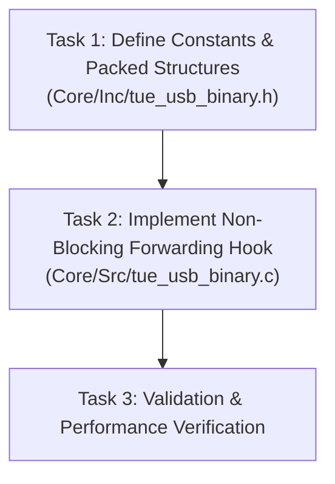

# STM32 Firmware Specification: USB-to-UART Tactile Haptic Forwarding Bridge

> **Target Workspace**: STM32 Firmware Repository (`Core/Inc`, `Core/Src`)  
> **Target Device**: STM32F407VET6 (`MM_Control`)  
> **Reference Documents**: [`USB_PROTOCOL.md`](USB_PROTOCOL.md), [`SENSOR_DATA_UART_PROTOCOL.md`](SENSOR_DATA_UART_PROTOCOL.md), [`HAPTIC_SLAVE_FIRMWARE_SPEC.md`](HAPTIC_SLAVE_FIRMWARE_SPEC.md)  
> **Input Interface**: USB CDC (Virtual COM Port) @ Full-Speed (1 Mbps nominal) from Host PC  
> **Output Interface**: Dedicated Hardware UART (e.g. `USART2`) @ **250,000 baud** (8-N-1) with **Dual DMA & Interrupts** to ESP32 Slave  

---

## 1. System Context & Teleoperation Role

The implementing agent must understand the physical context and hardware boundaries of the system:

```
===================================================================================================
                                      TELEOPERATION SYSTEM CONTEXT
===================================================================================================

       [ MASTER SYSTEM (ROBOT GRIPPER) ]                              [ SLAVE SYSTEM (OPERATOR HAPTICS) ]
       
         Left Jaw Sensor      Right Jaw Sensor                           Wearable Pneumatic Sleeve (SUP/Ring)
          (USB COM Port)       (USB COM Port)                                 On Single Operator Finger
        ┌───────────────┐    ┌───────────────┐                               
        │ Chuôi (Base)  │    │ Chuôi (Base)  │                                   Chamber D (Hông Trái)
        │     Giữa      │    │     Giữa      │                                            ▼
        │  Ngọn (Tip)   │    │  Ngọn (Tip)   │                                ┌───────────────────────┐
        └───────┬───────┘    └───────┬───────┘                                │   NGÓN TAY NGƯỜI ĐEO  │
                │ Fz_L               │ Fz_R                                   └───────────────────────┘
                └─────────┬──────────┘                                                    ▲
                          │                                                      Chamber E (Hông Phải)
                          ▼                                                  
                   [ 2x USB Ports ]                                          [ MẶT DƯỚI ĐỆM NGÓN TAY ]
                          │                                                  ┌───────┬───────┬───────┐
                          ▼                                                  │   A   │   B   │   C   │
                ┌──────────────────┐                                         └───────┴───────┴───────┘
                │     HOST PC      │                                           Ngọn    Giữa    Chuôi
                │  (PYTHON CORE)   │                                          (Tip)    (Mid)   (Base)
                └─────────┬────────┘                                                      ▲
                          │                                                               │
                          ▼ (USB CDC @ 1 Mbps, CAN ID 0x300, 20 Bytes)                    │
                ┌──────────────────┐                                                      │
                │  STM32F407 MASTER│ ────────► (Hardware UART @ 250k baud, 20 Bytes) ─────┘
                │   (ROBOT PCB)    │                ESP32 WROOM SLAVE CONTROLLER
                └──────────────────┘                 (5x MCP4725 DACs -> 5 Valves)
===================================================================================================
```

### 1.1 Master System Overview
* **Robotic Gripper**: 2-finger parallel gripper (Left & Right jaws) pointing vertically downward.
* **Tactile Instrumentation**: Dual 6-axis tactile sensor arrays reading normal forces ($F_z$), shear forces ($F_y, F_x$), CoP, and 52-taxel pressure maps. Sensors stream directly to the Host PC via USB.
* **Master Controller (STM32F407VET6)**: Controls motion kinematics (CoreXY, Z-axis, gripper motors). Connects to Host PC via USB CDC.

### 1.2 Slave System Overview
* **Wearable Interface**: A 5-chamber pneumatic silicone thimble worn on a single finger of the human operator.
* **Slave Controller**: ESP32-WROOM controlling 5 MCP4725 DACs and proportional valves.
  * **Chambers D & E (Sides)**: Squeeze the sides of the finger to render bilateral clamping forces ($F_{z, L}, F_{z, R}$).
  * **Chambers A, B, C (Bottom)**: Actuate the underside of the finger (tip, mid, base) to render object weight / vertical slip force ($\bar{F}_{\text{shear}}$) across spatial zones ($w_A, w_B, w_C$).

### 1.3 Role of the STM32 Firmware
The STM32 sits as the central hardware bridge between the Host PC and the ESP32 slave:
1. **High-Speed Ingestion**: Ingest the single unified 20-byte packet (CAN ID: `0x300`) sent from Host PC via USB CDC at $100\text{ Hz}$.
2. **Local Telemetry Cache**: Extract and store the 8-byte payload in firmware memory for local reflex control (e.g. slip compensation, force limiting) and high-speed data logging.
3. **Non-Blocking Forwarding**: Forward the exact 20-byte frame to the ESP32 slave via hardware UART at **250,000 baud** using **Dual DMA (TX & RX) and NVIC Interrupts**, guaranteeing zero jitter on stepper motor pulse generation.

---

## 2. Protocol & Wire Data Contract

The packet received from USB CDC and forwarded over UART is identical (transparent pass-through).

### 2.1 Frame Envelope Specification (20 Bytes Fixed)
* **Preamble (2 Bytes)**: `0xAA 0x55`
* **Header (7 Bytes)**:
  * `FRAME_TYPE` (1 Byte): `0x01` (`FRAME_TYPE_REQ`)
  * `CAN_ID` (4 Bytes): `0x00000300` (Little-Endian: `0x00, 0x03, 0x00, 0x00`)
  * `DLC` (1 Byte): `0x08` (Strictly 8 bytes payload)
  * `SEQ` (1 Byte): Rolling sequence counter echoed transparently
* **Payload (8 Bytes)**: Unified Haptic Telemetry
  * `Byte 0`: `Fz_Left` ($0.1\text{ N}$ / LSB, $0..25.5\text{ N}$) $\to$ Drives Van D (Hông trái ngón)
  * `Byte 1`: `Fz_Right` ($0.1\text{ N}$ / LSB, $0..25.5\text{ N}$) $\to$ Drives Van E (Hông phải ngón)
  * `Byte 2`: `F_shear_avg` ($0.1\text{ N}$ / LSB, $0..25.5\text{ N}$) $\to$ Object weight / slip force
  * `Byte 3`: `Weight_Tip` ($w_A$: $0..255 \to 0.0..1.0$) $\to$ Zone 1 Tip weight (Van A - Ngọn)
  * `Byte 4`: `Weight_Mid` ($w_B$: $0..255 \to 0.0..1.0$) $\to$ Zone 2 Mid weight (Van B - Giữa)
  * `Byte 5`: `Weight_Base` ($w_C$: $0..255 \to 0.0..1.0$) $\to$ Zone 3 Base weight (Van C - Chuôi)
  * `Byte 6`: `Status_Flags` (Bitmask: Bit 0 = Left Contact, Bit 1 = Right Contact, Bit 2 = Slip Alert, Bit 3 = Tare Active)
  * `Byte 7`: `Frame_Counter` ($0..255$ rolling cycle counter)
* **Checksum (1 Byte)**: SAE J1850 CRC-8 calculated over Bytes `2 .. 16`
* **Postamble (2 Bytes)**: `0x55 0xAA`

---

## 3. Peripheral Hardware Strategy: Dual DMA & Interrupts

### 3.1 Timing & Baud Rate Parameters
* **Baud Rate**: **250,000 bps** (8 data bits, no parity, 1 stop bit).
* **Clock Source**: APB1 Peripheral Clock ($42\text{ MHz}$ on standard $168\text{ MHz}$ STM32F407 core).
* **Divider Calculation**:
  $$\text{USARTDIV} = \frac{f_{\text{PCLK1}}}{16 \times \text{BaudRate}} = \frac{42,000,000}{16 \times 250,000} = 10.500$$
  * Mantissa = `10` (`0x0A`), Fraction = $0.5 \times 16 = 8$ (`0x08`).
  * **Resulting Baud Rate Error**: **$0.00\%$** (exact integer fraction).
* **Wire Transmission Time**:
  $$\text{Wire Time per Frame} = \frac{20\text{ bytes} \times 10\text{ bits}}{250,000\text{ bps}} = 800\ \mu\text{s} = 0.80\text{ ms}$$
  * At $100\text{ Hz}$ update rate ($10\text{ ms}$ period), channel utilization is **$8.0\%$** (line is idle $92\%$ of the time).

### 3.2 Dual DMA & Interrupt Architecture
To ensure zero CPU blocking on motor pulse generation, both TX and RX must be routed through DMA:
* **UART Instance**: Dedicated peripheral, e.g. `USART2` (Pins: `PD5` = TX, `PD6` = RX).
* **DMA Controller**: `DMA1`.
  * **DMA TX**: `DMA1_Stream6`, Channel 4 (Mode: `DMA_CIRCULAR`, Memory $\to$ Peripheral).
  * **DMA RX**: `DMA1_Stream5`, Channel 4 (Mode: `DMA_NORMAL`, Peripheral $\to$ Memory).
* **NVIC Interrupt Vectors**:
  * `USART2_IRQn`: Line Idle event detection (`UART_IT_IDLE`) and framing error management.
  * `DMA1_Stream6_IRQn`: TX Transfer Complete notification for buffer release.
  * `DMA1_Stream5_IRQn`: RX Transfer Complete / Event notification for incoming slave feedback.

---

## 4. Implementation Outline for the Agent

The implementing agent must follow this modular task sequence to update the STM32 codebase:



### Task 1: Data Types & Structures (`Core/Inc/tue_usb_binary.h`)
* **Constants**:
  * Define CAN ID macro for unified tactile haptic stream: `0x00000300U`.
  * Define status bitmask flags (`LEFT_CONTACT = 0x01`, `RIGHT_CONTACT = 0x02`, `SLIP_ALERT = 0x04`, `TARE_ACTIVE = 0x08`).
* **Data Structures (`#pragma pack(push, 1)`)**:
  * Define payload struct (8 bytes): `fz_left`, `fz_right`, `f_shear_avg`, `weight_tip`, `weight_mid`, `weight_base`, `status_flags`, `frame_counter`.
  * Define wire frame struct (20 bytes): `sof1`, `sof2`, `frame_type`, `can_id`, `dlc`, `seq`, payload struct, `crc8`, `eof1`, `eof2`.
* **State Exposure**:
  * Declare an external volatile instance of the payload struct and a 32-bit timestamp to allow access across the firmware.

### Task 2: UART & Dual DMA Driver (`Core/Src/usart.c` & `Core/Inc/usart.h`)
* **Handle Management**:
  * Instantiate UART handle (`huart_slave`) and two DMA handles (`hdma_usart_slave_tx`, `hdma_usart_slave_rx`).
* **Peripheral Initialization (`MX_Slave_UART_Init`)**:
  * Configure instance (e.g. USART2), baud rate `250000`, 8-N-1, hardware flow control none.
  * Arm circular DMA reception using `HAL_UARTEx_ReceiveToIdle_DMA()` with a dedicated circular buffer (e.g. 128 bytes).
  * Disable Half-Transfer interrupt on RX DMA to minimize unnecessary ISR overhead.
* **Hardware MSP Hook (`HAL_UART_MspInit`)**:
  * Enable peripheral clocks: USART clock, GPIO clock, and DMA clock.
  * Configure TX and RX pins in Alternate Function mode with pull-up resistors and very high speed.
  * Configure DMA TX Stream: Memory-to-peripheral direction, memory increment enabled, peripheral increment disabled, normal mode.
  * Configure DMA RX Stream: Peripheral-to-memory direction, memory increment enabled, peripheral increment disabled, circular mode.
  * Link DMA handles to the UART handle using `__HAL_LINKDMA()`.
  * Set NVIC interrupt priorities (priority 5, lower than stepper motor timers) and enable IRQs for USART and both DMA streams.

### Task 3: Interrupt Service Routines (`Core/Src/stm32f4xx_it.c`)
* In the interrupt service file, map the hardware IRQs to their respective HAL drivers:
  * `USART2_IRQHandler` $\to$ Forward to `HAL_UART_IRQHandler(&huart_slave)`.
  * `DMA1_Stream6_IRQHandler` (TX) $\to$ Forward to `HAL_DMA_IRQHandler(&hdma_usart_slave_tx)`.
  * `DMA1_Stream5_IRQHandler` (RX) $\to$ Forward to `HAL_DMA_IRQHandler(&hdma_usart_slave_rx)`.

### Task 4: Ingestion & Non-Blocking Forwarding Engine (`Core/Src/tue_usb_binary.c`)
* **Double-Buffering Architecture**:
  * Allocate a 2-slot ping-pong buffer (`2 x 20 bytes`) in static RAM for DMA TX.
  * Maintain a busy flag (`s_dma_tx_busy`) and buffer index to prevent memory race conditions when a new USB packet arrives while the previous $800\ \mu\text{s}$ DMA transfer is active.
* **DMA TX Completion Callback (`HAL_UART_TxCpltCallback`)**:
  * When USART instance matches the slave UART, clear the `s_dma_tx_busy` flag.
* **DMA RX Event Callback (`HAL_UARTEx_RxEventCallback`)**:
  * Process any return status or telemetry sent back by the ESP32 slave, then re-arm DMA reception via `HAL_UARTEx_ReceiveToIdle_DMA()`.
* **USB CDC Ingestion Hook (`tue_usb_dispatch_frame`)**:
  * Filter for incoming frames with `can_id == 0x300` and `dlc == 8`.
  * Copy payload into the local volatile telemetry cache and update timestamp with `HAL_GetTick()`.
  * Optional: Check the `SLIP_ALERT` flag to trigger immediate firmware-level reflex actions (e.g. adaptive grip tightening).
  * Forward the exact 20 raw frame bytes to the slave UART via non-blocking DMA using the ping-pong buffer.
  * Return immediately without generating a return USB ACK packet (fire-and-forget streaming).

---

## 5. Critical Constraints & Safety Rules

1. **Strict Zero-Blocking Rule**: Never invoke blocking functions (such as `HAL_UART_Transmit()` with timeout) inside the USB RX callback or interrupt context. Transmission must always be dispatched via DMA.
2. **Memory Safety**: The DMA transmit source must point to a persistent static RAM buffer (ping-pong buffer). Never pass pointers to transient stack variables or USB FIFO buffers that could be overwritten before DMA completes.
3. **Interrupt Priority Hierarchy**: Ensure UART and DMA interrupt priorities (e.g., priority 5) are strictly lower than high-frequency stepper motor pulse generation timer interrupts (e.g., priority 0 or 1).

---

## 6. Verification & Acceptance Criteria

The implementing agent must verify the implementation against the following standards:

| Test Item | Specification Standard | Verification Method |
|:---|:---|:---|
| **Baud Rate Accuracy** | Bit duration $= 4.00\ \mu\text{s} \pm 0.5\%$ | Oscilloscope / Logic Analyzer on TX pin (`PA2`) |
| **Forwarding Latency** | $< 5.0\ \mu\text{s}$ from USB packet parse to UART start bit | Dual-channel oscilloscope trigger (USB D+ vs UART TX) |
| **Data Transparency** | Exact byte-for-byte match (all 20 bytes including CRC) | Compare USB input buffer vs UART output capture |
| **Motion Stability** | 0% jitter on stepper motor pulse generation | Run CoreXY motor moves during continuous 100 Hz streaming |
| **DMA Independence** | CPU usage for forwarding $< 0.1\%$ | Profiler / CPU load measurement |
